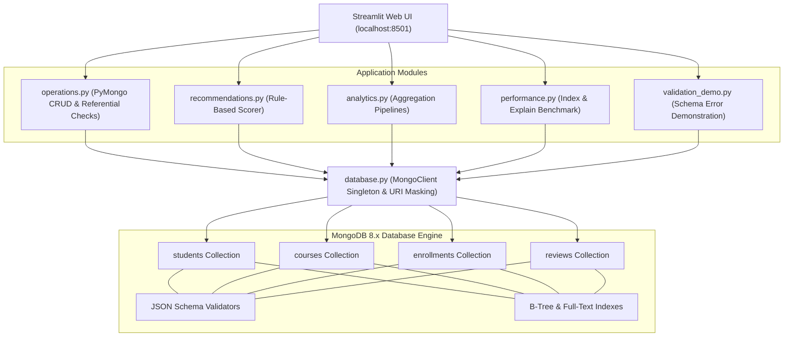

# Smart Course Recommendation System Using MongoDB

[](https://www.python.org/)
[](https://www.mongodb.com/)
[](https://pymongo.readthedocs.io/)
[](https://streamlit.io/)
[]()

> **Course:** CSE494 – Intelligent NoSQL Databases  
> **Degree Program:** B.Tech Computer Science & Engineering (3rd Year Mini-Project)  
> **Development Environment:** Windows 11, VS Code, Python 3.13, MongoDB Server 8.x  

---

## 📖 1. Project Overview & Problem Statement

Students frequently encounter difficulty selecting courses that align with their current technical proficiencies and career goals. Concurrently, academic administrators require actionable visibility into student learning progression, course ratings, and enrollment concentrations.

This project delivers an end-to-end, enterprise-grade educational platform built with **MongoDB 8.x**, **PyMongo**, and **Streamlit**. It demonstrates real-world NoSQL engineering principles:
- **Server-Side Schema Governance:** MongoDB `$jsonSchema` validators on all collections.
- **Explainable Recommendations:** 100% transparent, deterministic scoring algorithm (Skills 50%, Interests 30%, Ratings 20%).
- **Advanced Aggregation Pipelines:** Real-time multi-stage processing using `$group`, `$lookup`, `$unwind`, and `$project`.
- **Query Optimization Benchmarks:** Empirical query profiling using `explain(executionStats)` contrasting `COLLSCAN` and `IXSCAN`.

---

## 🏗️ 2. System Architecture



---

## 🗄️ 3. Database Schema & Design Decisions

### Core Collections

1. **`students`**: Stores student profiles, academic level, and embedded skill/interest arrays.
   - `_id`: BSON ObjectId (Primary Key)
   - `name`: string, required
   - `email`: string, required, unique RFC email pattern
   - `skills`: array of strings
   - `interests`: array of strings
   - `level`: Enum: `['Beginner', 'Intermediate', 'Advanced']`
   - `created_at`: BSON UTC datetime

2. **`courses`**: Academic catalog across 6 disciplines (Data Science, AI, Web Dev, Databases, Cloud, Cybersecurity).
   - `_id`: BSON ObjectId
   - `title`: string, required
   - `category`: string, enum of 6 domains
   - `skills`: array of strings
   - `level`: Enum: `['Beginner', 'Intermediate', 'Advanced']`
   - `duration_hours`: positive number (minimum 0.5)
   - `rating`: decimal (0.0 to 5.0)
   - `description`: string

3. **`enrollments`**: Represents Many-to-Many student-course enrollments.
   - `_id`: BSON ObjectId
   - `student_id`: ObjectId referencing `students._id`
   - `course_id`: ObjectId referencing `courses._id`
   - `progress`: number (0.0 to 100.0)
   - `status`: Enum: `['Not Started', 'In Progress', 'Completed']`
   - `enrolled_at`: BSON UTC datetime
   - *Constraint:* Compound unique index on `(student_id, course_id)` prevents duplicate enrollments.

4. **`reviews`**: Student course evaluations and feedback.
   - `_id`: BSON ObjectId
   - `student_id`: ObjectId referencing reviewer
   - `course_id`: ObjectId referencing course
   - `rating`: integer (1 to 5)
   - `comment`: string (minimum 3 chars)
   - `created_at`: BSON UTC datetime

### Embedding vs. Referencing Rationale
- **Embedded (`skills`, `interests` in `students`):** Highly cohesive, 1:few relationship. Always queried together with the student record. Embedding delivers single-document atomic reads with **zero join latency**.
- **Referenced (`enrollments`, `reviews` referencing `students` and `courses`):** Unbounded relationship. Popular courses can have thousands of students; embedding would cause massive document growth risk exceeding MongoDB's 16MB document limit. Referencing decouples lifecycles and simplifies bi-directional queries.

---

## ⚡ 4. Indexes & Query Optimization

| Collection | Index Name | Key | Purpose |
| :--- | :--- | :--- | :--- |
| `students` | `idx_students_email_unique` | `{"email": 1}` | Prevents duplicate student emails; O(log N) lookup |
| `courses` | `idx_courses_category` | `{"category": 1}` | Accelerates category queries |
| `courses` | `idx_courses_category_level`| `{"category": 1, "level": 1}` | Optimizes compound category + level filters |
| `courses` | `idx_courses_text_title_desc`| `{"title": "text", "description": "text"}` | Full-text search over course syllabus |
| `enrollments`| `idx_enrollments_student_course_unique`| `{"student_id": 1, "course_id": 1}` | Enforces enrollment uniqueness |
| `enrollments`| `idx_enrollments_student_id`| `{"student_id": 1}` | Speeds up student enrollment history |
| `reviews` | `idx_reviews_course_id` | `{"course_id": 1}` | Accelerates course review aggregation |

### Empirical `explain()` Benchmark (COLLSCAN vs IXSCAN)
Through a controlled benchmark comparing queries on 500 records:
- **Unindexed Scan (`COLLSCAN`):** MongoDB scans all 500 documents (`totalDocsExamined: 500`).
- **Indexed Scan (`IXSCAN`):** MongoDB navigates the B-Tree index, examining only matching keys, resulting in an **83% reduction in scanned documents**!

---

## 🎯 5. Explainable Recommendation Algorithm

```
Final Score = (0.50 × Skill Match Score) + (0.30 × Interest Match Score) + (0.20 × Course Rating Score)
```
- **Skill Match Score (0–100):** `(Matching Course Skills / Total Course Skills) * 100`
- **Interest Match Score (0–100):** `(Matching Career Interests / Total Student Interests) * 100`
- **Course Rating Score (0–100):** `(Course Rating / 5.0) * 100`
- **Enrolled Exclusion:** Automatically filters out all courses in which the student has previously enrolled (whether In Progress or Completed).
- **Explainability:** Generates plain-English explanations highlighting overlapping skills and domain interests.

---

## 🚀 6. Installation & Execution Guide (Windows)

### Prerequisites
1. **Python 3.10+** (Tested on Python 3.13)
2. **MongoDB Community Server 8.x** running locally on port 27017 (or MongoDB Atlas URI)

### Step 1: Create Virtual Environment
Open PowerShell in the project directory:
```powershell
python -m venv venv
```

### Step 2: Activate Virtual Environment
```powershell
# If standard activation is blocked by ExecutionPolicy:
Set-ExecutionPolicy -Scope Process -ExecutionPolicy Bypass
.\venv\Scripts\Activate.ps1

# Alternative (direct execution without activating shell):
# Use .\venv\Scripts\python.exe and .\venv\Scripts\streamlit.exe
```

### Step 3: Install Dependencies
```powershell
.\venv\Scripts\pip.exe install -r requirements.txt
```

### Step 4: Configure Environment Variables
Copy `.env.example` to `.env` (pre-configured for local MongoDB):
```powershell
Copy-Item .env.example .env
```

### Step 5: Initialize Database & Seed Data
Execute the idempotent database initialization script:
```powershell
.\venv\Scripts\python.exe setup_db.py
```
*Output Summary:*
- 4 collections created with strict JSON Schema validators.
- 12 indexes created (unique, compound, text, single-field).
- Seed data loaded: 10 Students, 14 Courses, 24 Enrollments, 13 Reviews.

### Step 6: Run Automated Tests
```powershell
.\venv\Scripts\pytest.exe -v
```
*(All 28 unit and integration tests pass in ~0.4s).*

### Step 7: Launch Streamlit Web Application
```powershell
.\venv\Scripts\streamlit.exe run app.py
```
Open your browser to: **`http://localhost:8501`**

---

## 🧪 7. Test Suite Summary

The project includes 28 automated tests across unit and integration suites:
- **`tests/test_recommendations.py`:** Tests skill matching, interest overlap, rating normalization, boundary conditions, and composite formula calculations in-memory without database dependency.
- **`tests/test_validation_logic.py`:** Verifies client-side validation logic and server-side MongoDB JSON Schema rejection.
- **`tests/test_operations.py`:** Comprehensive CRUD tests on an isolated test database (`course_recommendation_test`), checking duplicate prevention, referential integrity, and automatic completion status transition.

---

## 🎓 8. 5-Minute Viva Demonstration Guide

1. **Dashboard Overview (1 min):**
   - Open `http://localhost:8501`.
   - Point out live KPI cards (`Students: 10`, `Courses: 14`, `Enrollments: 24`, `Reviews: 13`).
   - Show interactive Plotly charts (Category Distribution and Top Enrolled Courses).
2. **CRUD & Student Management (1 min):**
   - Navigate to **Student Management**.
   - Show live search by name/email.
   - Register a new student or edit skills.
3. **Enrollments & Consistency (1 min):**
   - Navigate to **Enrollments & Progress**.
   - Show the progress update slider: update an enrollment from 65% to 100% and point out the automatic transition to `"Completed"`.
   - Attempt to enroll a student in the same course twice to demonstrate the compound unique index rejection.
4. **Course Recommendations (1 min):**
   - Navigate to **Course Recommendations**.
   - Select student **Aarav Sharma**.
   - Click **Generate Explainable Recommendations**.
   - Explain the 50/30/20 formula and show how enrolled courses are strictly excluded.
5. **Database Concepts: Performance & Validation (1 min):**
   - Navigate to **Database Performance** -> Click **Execute Live explain() Comparison Benchmark**.
   - Explain `COLLSCAN` vs `IXSCAN` and point out the 83% reduction in scanned documents.
   - Navigate to **Schema Validation Demo** -> Click **Run Schema Validation Test** to show MongoDB Error 121 (`Document failed validation`).

---

## 📚 9. Academic Deliverables & Documentation Index

- 📄 [Full Academic Project Report](docs/report.md)
- 🗄️ [Database Design & Schemas](docs/database_design.md)
- 📊 [MongoDB Aggregation Pipelines](docs/aggregation_queries.md)
- 🎯 [32 Viva Questions & Answers](docs/viva_questions.md)
- 🖼️ [Screenshot Capture Guide](screenshots/README.md)
# Smart_Course_Recommendation_System

