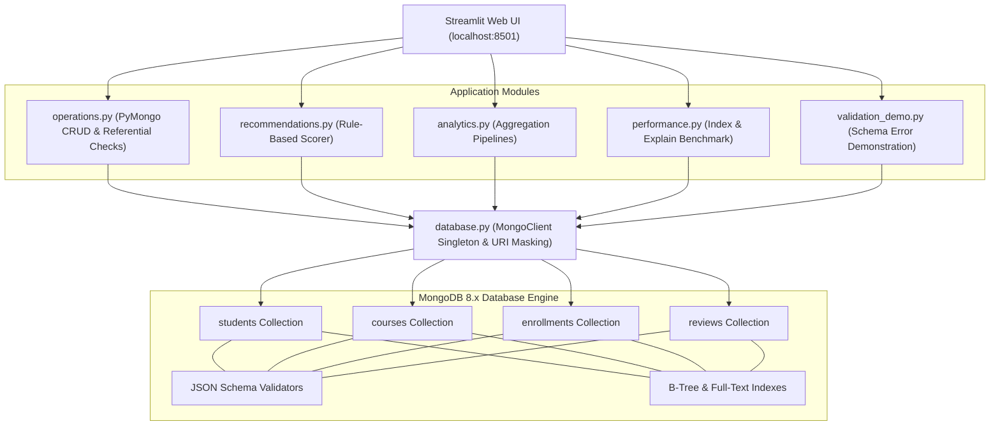

# Smart Course Recommendation System Using MongoDB

[](https://www.python.org/) [](https://www.mongodb.com/) [](https://pymongo.readthedocs.io/) [](https://streamlit.io/) []()

> **Course:** CSE494 – Intelligent NoSQL Databases  
> **Degree Program:** B.Tech Computer Science & Engineering (3rd Year Mini-Project)  
> **Development Environment:** Windows 11, VS Code, Python 3.13, MongoDB Server 8.x

---

## 📖 1. Project Overview & Problem Statement

Students frequently encounter difficulty selecting courses that align with their current technical proficiencies and career goals. Concurrently, academic administrators require actionable visibility into student learning progression, course ratings, and enrollment concentrations.

This project delivers an end-to-end educational platform built with **MongoDB 8.x**, **PyMongo**, and **Streamlit**. It demonstrates real-world NoSQL engineering principles:

- **Server-Side Schema Governance:** MongoDB `$jsonSchema` validators on all collections.
- **Explainable Recommendations:** Transparent, deterministic scoring algorithm using Skills (50%), Interests (30%), and Ratings (20%).
- **Advanced Aggregation Pipelines:** Multi-stage processing using `$group`, `$lookup`, `$unwind`, and `$project`.
- **Query Optimization Benchmarks:** Empirical query profiling using `explain(executionStats)` to compare `COLLSCAN` and `IXSCAN`.

---

## 🏗️ 2. System Architecture



---

## 🗄️ 3. Database Schema & Design Decisions

### Core Collections

**1. `students`**

Stores student profiles, academic levels, and embedded skill and interest arrays.

- `_id`: BSON ObjectId (Primary Key)
- `name`: Required string
- `email`: Required string with a unique constraint and email-format validation
- `skills`: Array of strings
- `interests`: Array of strings
- `level`: Enum: `Beginner`, `Intermediate`, `Advanced`
- `created_at`: BSON UTC datetime

**2. `courses`**

Stores the academic catalog across six disciplines: Data Science, AI, Web Development, Databases, Cloud, and Cybersecurity.

- `_id`: BSON ObjectId
- `title`: Required string
- `category`: String restricted to six supported domains
- `skills`: Array of strings
- `level`: Enum: `Beginner`, `Intermediate`, `Advanced`
- `duration_hours`: Positive number, minimum 0.5
- `rating`: Numeric value from 0.0 to 5.0
- `description`: String

**3. `enrollments`**

Represents the many-to-many relationship between students and courses.

- `_id`: BSON ObjectId
- `student_id`: ObjectId referencing `students._id`
- `course_id`: ObjectId referencing `courses._id`
- `progress`: Number from 0.0 to 100.0
- `status`: Enum: `Not Started`, `In Progress`, `Completed`
- `enrolled_at`: BSON UTC datetime
- **Constraint:** A compound unique index on `(student_id, course_id)` prevents duplicate enrollments.

**4. `reviews`**

Stores student course evaluations and feedback.

- `_id`: BSON ObjectId
- `student_id`: ObjectId referencing the reviewer
- `course_id`: ObjectId referencing the course
- `rating`: Integer from 1 to 5
- `comment`: String with a minimum length of three characters
- `created_at`: BSON UTC datetime

### Embedding vs. Referencing Rationale

- **Embedded (`skills`, `interests` in `students`):** These closely related attributes are frequently accessed with the student record. Embedding supports single-document reads without an additional lookup.
- **Referenced (`enrollments`, `reviews`):** Enrollment and review relationships can grow substantially. Referencing avoids unbounded document growth and supports independent queries across students and courses.

---

## ⚡ 4. Indexes & Query Optimization

| Collection | Index Name | Key | Purpose |
|---|---|---|---|
| `students` | `idx_students_email_unique` | `{"email": 1}` | Enforces unique emails and accelerates lookups |
| `courses` | `idx_courses_category` | `{"category": 1}` | Accelerates category queries |
| `courses` | `idx_courses_category_level` | `{"category": 1, "level": 1}` | Optimizes combined category and level filters |
| `courses` | `idx_courses_text_title_desc` | `{"title": "text", "description": "text"}` | Full-text course search |
| `enrollments` | `idx_enrollments_student_course_unique` | `{"student_id": 1, "course_id": 1}` | Enforces enrollment uniqueness |
| `enrollments` | `idx_enrollments_student_id` | `{"student_id": 1}` | Speeds up enrollment history queries |
| `reviews` | `idx_reviews_course_id` | `{"course_id": 1}` | Accelerates course review queries |

### Empirical `explain()` Benchmark: COLLSCAN vs. IXSCAN

A controlled benchmark compares query execution on 500 records.

- **Unindexed Scan (`COLLSCAN`):** MongoDB scans all 500 documents, reported as `totalDocsExamined: 500`.
- **Indexed Scan (`IXSCAN`):** MongoDB uses a B-tree index to locate matching keys and documents, potentially reducing the number of documents examined.

The benchmark reports an **83% reduction in scanned documents** under the tested conditions. Results may vary with the query, dataset, and index selectivity.

---

## 🎯 5. Explainable Recommendation Algorithm

The system calculates a composite recommendation score:

```text
Final Score =
    (0.50 × Skill Match Score)
  + (0.30 × Interest Match Score)
  + (0.20 × Course Rating Score)
```

- **Skill Match Score (0–100):** `(Matching Course Skills / Total Course Skills) × 100`
- **Interest Match Score (0–100):** `(Matching Career Interests / Total Student Interests) × 100`
- **Course Rating Score (0–100):** `(Course Rating / 5.0) × 100`
- **Enrolled Course Exclusion:** Filters out courses in which the student is already enrolled, including courses marked `In Progress` or `Completed`.
- **Explainability:** Generates plain-English explanations highlighting overlapping skills and domain interests.

---

## 🚀 6. Installation & Execution Guide (Windows)

### Prerequisites

1. Python 3.10+ (tested with Python 3.13)
2. MongoDB Community Server 8.x running locally on port `27017`, or a configured MongoDB Atlas URI.

### Step 1: Create a Virtual Environment

Open PowerShell in the project directory:

```powershell
python -m venv venv
```

### Step 2: Activate the Virtual Environment

```powershell
.\venv\Scripts\Activate.ps1
```

If PowerShell blocks activation, use a process-scoped execution policy:

```powershell
Set-ExecutionPolicy -Scope Process -ExecutionPolicy Bypass
.\venv\Scripts\Activate.ps1
```

Alternatively, run the virtual environment executables directly without activating it.

### Step 3: Install Dependencies

```powershell
.\venv\Scripts\python.exe -m pip install -r requirements.txt
```

### Step 4: Configure Environment Variables

Copy `.env.example` to `.env`:

```powershell
Copy-Item .env.example .env
```

Review the environment variables before running the application. Never commit credentials or private connection strings.

### Step 5: Initialize the Database and Seed Data

```powershell
.\venv\Scripts\python.exe setup_db.py
```

Expected setup summary, assuming the supplied seed data and initialization script produce these results:

- Four collections configured with JSON Schema validators.
- Twelve indexes created.
- Seed data loaded: 10 students, 14 courses, 24 enrollments, and 13 reviews.

### Step 6: Run Automated Tests

```powershell
.\venv\Scripts\python.exe -m pytest -v
```

The project is documented as having 28 unit and integration tests. Run the suite to verify the current results in your environment.

### Step 7: Launch the Streamlit Application

```powershell
.\venv\Scripts\python.exe -m streamlit run app.py
```

Open the application at:

**http://localhost:8501**

---

## 🧪 7. Test Suite Summary

The project includes 28 automated tests across unit and integration suites.

- **`tests/test_recommendations.py`:** Tests skill matching, interest overlap, rating normalization, boundary conditions, and composite score calculations.
- **`tests/test_validation_logic.py`:** Verifies client-side validation and MongoDB JSON Schema rejection.
- **`tests/test_operations.py`:** Tests CRUD operations against an isolated test database, including duplicate prevention, referential integrity, and automatic completion status transitions.

Run the test suite to confirm the current pass count.

---

## 🎓 8. Five-Minute Viva Demonstration Guide

### 1. Dashboard Overview (1 minute)

- Open `http://localhost:8501`.
- Present the KPI cards for students, courses, enrollments, and reviews.
- Demonstrate the category distribution and top-enrolled-course charts.

### 2. CRUD and Student Management (1 minute)

- Navigate to **Student Management**.
- Demonstrate live search by name or email.
- Register a new student or update an existing student's skills.

### 3. Enrollments and Consistency (1 minute)

- Navigate to **Enrollments & Progress**.
- Update enrollment progress from 65% to 100%.
- Demonstrate the automatic transition to `Completed`.
- Attempt a duplicate enrollment to demonstrate the unique compound index.

### 4. Course Recommendations (1 minute)

- Navigate to **Course Recommendations**.
- Select student **Aarav Sharma**, if present in the seeded data.
- Generate explainable recommendations.
- Explain the 50/30/20 scoring formula and enrolled-course exclusion.

### 5. Database Performance and Validation (1 minute)

- Open **Database Performance** and execute the `explain()` comparison benchmark.
- Explain `COLLSCAN` versus `IXSCAN`.
- Open **Schema Validation Demo** and demonstrate MongoDB validation error 121 using an intentionally invalid document.

---

## 📚 9. Academic Deliverables & Documentation Index

- 📄 [Full Academic Project Report](docs/report.md)
- 🗄️ [Database Design & Schemas](docs/database_design.md)
- 📊 [MongoDB Aggregation Pipelines](docs/aggregation_queries.md)
- 🎯 [32 Viva Questions & Answers](docs/viva_questions.md)
- 🖼️ [Screenshot Capture Guide](screenshots/README.md)

---

**Smart Course Recommendation System Using MongoDB**  
*CSE494 – Intelligent NoSQL Databases*
