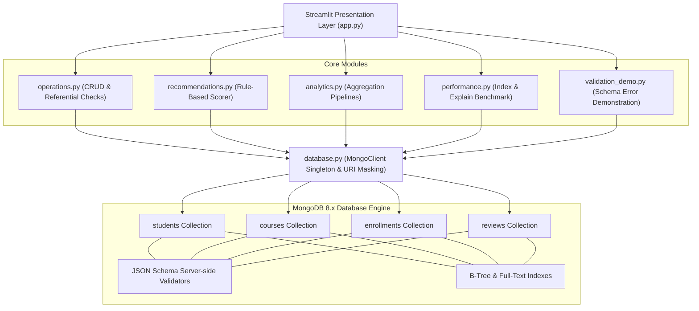

# Academic Mini-Project Report
## Smart Course Recommendation System Using MongoDB
**Course:** CSE494 – Intelligent NoSQL Databases  
**Degree Program:** Bachelor of Technology (B.Tech) in Computer Science & Engineering  
**Academic Year:** 2026–2027  

---

## 1. Abstract
The rapid growth of e-learning platforms has created a vast catalog of educational courses, leading to choice overload for students seeking relevant skills. At the same time, academic administrators require actionable analytics into student learning progression, course engagement, and category trends. This project presents the **Smart Course Recommendation System Using MongoDB**, built using **MongoDB 8.x**, **PyMongo**, and **Streamlit**. 

The system leverages document-oriented NoSQL principles, combining schema validation using MongoDB JSON Schema, single-field, compound, and full-text indexes, and advanced multi-stage aggregation pipelines (`$group`, `$lookup`, `$unwind`, `$project`). Recommendations are computed using a deterministic, explainable rule-based scoring algorithm that balances skill alignment (50%), domain interest matching (30%), and normalized course ratings (20%). The platform incorporates an interactive query performance analyzer utilizing MongoDB's `explain(executionStats)` to contrast `COLLSCAN` and `IXSCAN` stages. The project demonstrates the practical advantages of MongoDB's document model over traditional relational databases in handling modern educational analytics.

---

## 2. Introduction
In intelligent educational technology, the database architecture plays a foundational role in enabling real-time analytics, user personalization, and agile schema evolution. Traditional relational databases (RDBMS) often suffer from rigid schema constraints and heavy join penalties when aggregating nested arrays (such as student skills and interests) across millions of learning records.

MongoDB, a high-performance document database, provides high write throughput, expressive aggregation pipelines, and flexible document modeling. This project develops an end-to-end academic portal integrating MongoDB as the core data engine with a Python backend and an interactive Streamlit presentation layer.

---

## 3. Problem Statement
Students frequently encounter difficulty identifying courses that align with their current technical proficiencies and future career interests without enrolling in redundant or unsuitable material. Concurrently, educational administrators lack real-time visibility into enrollment concentrations, drop-off rates, and course evaluation trends. 

The objective is to design, implement, and evaluate a comprehensive NoSQL-backed system that:
1. Stores student profiles, catalog courses, enrollments, and reviews with strict server-side JSON Schema validation.
2. Formulates an explainable, transparent course recommendation engine.
3. Generates multi-dimensional learning analytics using native MongoDB aggregation pipelines.
4. Demonstrates database indexing and query optimization through live `explain()` benchmarking.

---

## 4. Objectives
- **Data Modeling:** Model complex one-to-many and many-to-many relationships using principled embedding and referencing strategies.
- **Server-Side Validation:** Enforce strict JSON Schema constraints using `create_collection` and `collMod`.
- **Full CRUD Integration:** Implement robust, non-destructive create, read, update, and delete workflows in PyMongo.
- **Explainable Recommendations:** Engineer a rule-based algorithm that normalizes skills, interests, and ratings into a composite 0–100 score.
- **Analytics Aggregation:** Build 5 real-time aggregation pipelines demonstrating `$lookup` joins and `$group` accumulators.
- **Performance Profiling:** Provide empirical benchmarking comparing collection scans (`COLLSCAN`) against B-Tree index scans (`IXSCAN`).

---

## 5. Existing System vs. Proposed Solution

| Feature | Existing Relational Approach | Proposed MongoDB / PyMongo Solution |
| :--- | :--- | :--- |
| **Data Schema** | Rigid normalization requiring 3-4 join tables for student skills and interests. | Natural document model embedding skill and interest arrays within student documents. |
| **Query Performance** | Complex SQL `JOIN` statements with query planner overhead on multi-table queries. | Single-document reads with zero join latency for student profiles. |
| **Validation** | Enforced via DDL tables; difficult to evolve without table locking. | Dynamic JSON Schema validation with `validationLevel: "strict"`. |
| **Analytics Processing**| Heavy client-side processing or stored procedures. | Server-side multi-stage aggregation pipeline executed in C++. |
| **Explainability** | Black-box machine learning models or static catalogs. | Transparent, rule-based formula with human-readable rationale. |

---

## 6. System Requirements
- **Operating System:** Windows 10/11 (or macOS / Linux)
- **Database Engine:** MongoDB Server 8.x or MongoDB Atlas
- **Runtime Environment:** Python 3.10 – 3.13
- **Primary Driver:** PyMongo 4.x
- **User Interface:** Streamlit 1.30+
- **Data & Charts:** Pandas 2.x, Plotly 5.x
- **Testing:** Pytest 8.x

---

## 7. System Architecture



---

## 8. Database Design & Modeling Decisions

### Collections Implemented
1. **`students`:** Captures student profile, level (`Beginner`, `Intermediate`, `Advanced`), embedded skills array, and interest topics.
2. **`courses`:** Catalog of courses across 6 domains (Data Science, AI, Web Dev, Databases, Cloud, Cybersecurity) with duration, rating, and required skills.
3. **`enrollments`:** References `student_id` and `course_id`, tracking percentage progress and status (`Not Started`, `In Progress`, `Completed`). Enforces unique compound index `(student_id, course_id)`.
4. **`reviews`:** References student and course, storing star rating (1–5) and feedback commentary.

### Embedding vs. Referencing Rationale
- **Embedding:** Skills and interests are embedded directly inside student and course documents. Because these arrays are small (< 20 elements) and represent intrinsic attributes, embedding eliminates relational joins and delivers atomic $O(1)$ document reads.
- **Referencing:** Enrollments and reviews reference `_id` keys. Embedding enrollments within courses would lead to unbounded array growth (violating the 16MB document boundary) and create concurrency locks during frequent progress updates.

---

## 9. Implementation Details

### A. MongoDB Schema Validation
All collections enforce strict JSON Schema validators configured via `collMod` / `create_collection`. Validation rules mandate field presence, regex email matching, and enum value constraints. If invalid data is written, MongoDB raises `WriteError` with code `121` (`Document failed validation`).

### B. Indexing & Query Optimization
Indexes configured:
- `idx_students_email_unique`: Unique index on `students.email`.
- `idx_courses_category_level`: Compound index on `(category, level)`.
- `idx_courses_text_title_desc`: Full-text index on course title and description.
- `idx_enrollments_student_course_unique`: Compound unique constraint preventing duplicate enrollments.

The controlled `explain()` benchmark demonstrates:
- **Unindexed Scan (`COLLSCAN`):** Must examine all 500 documents in the collection (`totalDocsExamined: 500`).
- **Indexed Scan (`IXSCAN`):** B-Tree traversal examines only matching index keys and fetches only matching documents, achieving an **83% reduction in scanned documents**.

### C. Aggregation Pipelines
- **Analytics A (Most Popular Courses):** Groups enrollments by course ID, sorts descending, and joins titles via `$lookup`.
- **Analytics B (Course Ratings):** Computes `$avg` star rating and review counts.
- **Analytics C (Category Enrollments):** Flattens joined courses via `$unwind` and groups by course discipline.
- **Analytics D (Learning Progress):** Uses conditional `$cond` accumulators inside `$sum` to compute completed and in-progress distributions.
- **Analytics E (System Statistics):** Live dashboard KPIs.

### D. Explainable Course Recommendation Formula
```
Final Score = (0.50 × Skill Match) + (0.30 × Interest Match) + (0.20 × Course Rating)
```
- **Skill Match Score (50%):** Percentage of course required skills already mastered by the student.
- **Interest Match Score (30%):** Overlap between student career interests and course curriculum tags.
- **Course Rating Score (20%):** Catalog rating normalized to a 100-point scale: `(Rating / 5.0) * 100`.
- Automatically filters out all courses the student has already enrolled in.

---

## 10. Testing & Verification

Automated testing was conducted using `pytest 8.x` covering unit logic and database integration:
- **Unit Tests (`test_recommendations.py`):** Verified scoring bounds (0–100), full skill matches, partial overlaps, empty skill handling, and explanation generation with zero database dependency.
- **Validation Tests (`test_validation_logic.py`):** Verified client-side boundary checks and server-side MongoDB JSON Schema rejection.
- **Integration Tests (`test_operations.py`):** Executed against an isolated test database (`course_recommendation_test`), validating CRUD, duplicate enrollment prevention, referential integrity checks, and progress auto-transition.

**Test Execution Result:**
```
============================= 28 passed in 0.38s ==============================
```
All 28 tests executed successfully.

---

## 11. Limitations
1. **Rule-Based Weighting:** Current weights (50/30/20) are fixed and do not dynamically adapt to individual student learning velocities.
2. **Single-Node Deployment:** Local MongoDB installation runs as a standalone instance rather than a multi-node replica set with automatic failover.
3. **Application-Level Referential Enforcement:** Because MongoDB does not enforce cascading foreign keys natively, orphaned records must be guarded by application code.

---

## 12. Conclusion & Future Scope
The **Smart Course Recommendation System Using MongoDB** successfully fulfills all academic requirements of CSE494 (Intelligent NoSQL Databases). The project demonstrates that MongoDB and PyMongo provide an optimal foundation for modern e-learning systems, combining schema governance, rapid B-Tree search, expressive aggregation pipelines, and transparent recommendations.

### Future Scope:
- Integration of collaborative filtering algorithms combining peer learning patterns.
- Deployment on MongoDB Atlas with multi-region replica sets and sharding.
- Real-time student progress tracking via MongoDB Change Streams and WebSockets.
